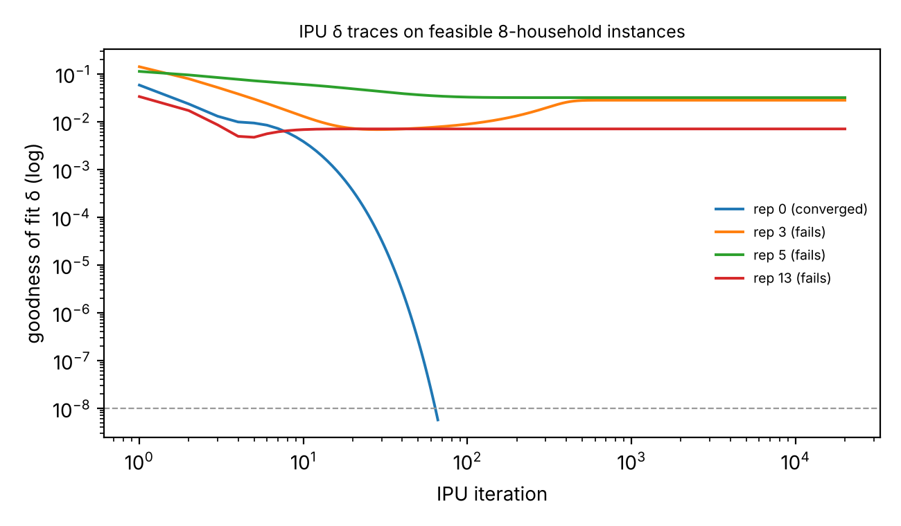

# Convergence verification: IPU against Ye et al. (2022)

V&V technique 2 in the proposal. Built 17 November 2026. No microdata.

## Why IPU, not IPF

The proposal says it will test Ye et al. (2022)'s convergence result on "the
fitting loop". That result is about iterative proportional updating (IPU;
Ye, Konduri et al. 2009), not IPF. An IPF trace cannot confirm or refute it.
So IPU is implemented here (`src/synthpop/ipu.py`) with its objective logged
every iteration, and tested on instances where the right answer is known to
exist.

**What Ye et al. (2022) claim (from the abstract; full text not yet checked).**
IPU is proved unable to converge to an optimal population distribution that
satisfies both individual- and household-level constraints. They propose a
bilevel optimisation in its place. The proposal paraphrased the result as "the
objective stops improving after the first iteration". The abstract does not say
that. Check the full text before the paper repeats either wording.

Citation: Ye, P., Tian, B., Lv, Y., Li, Q., & Wang, F.-Y. (2022). On iterative
proportional updating: Limitations and improvements for general population
synthesis. *IEEE Transactions on Cybernetics*, 52(3), 1726–1735.
doi:10.1109/TCYB.2020.2991427 (online 2020).

## Implementation

- **Input:** a households × constraints frequency matrix `D` and a vector of
  control totals `c`. Household-type columns are 0/1, and person-type columns
  count the members of that type.
- **One iteration:** for each constraint *j* in order, multiply the weight of
  every household with `D[i, j] > 0` by `c_j / Σ_i D[i, j] w_i`. Constraint *j*
  then holds exactly.
- **Fit statistic:** δ = mean_j |Σ_i D[i, j] w_i − c_j| / c_j (Ye et al. 2009).
  It is recorded before the first iteration and after each one
  (`IPUResult.history`).
- **Convergence:** reached when the largest relative residual is at most `tol`.
  A run that stops for any other reason is reported as not converged, and
  `strict=True` raises `IPUConvergenceError`. This follows the fail-loudly rule
  of `ipf`.
- **Ye et al. (2009)'s stopping rule** (stop when δ stops improving) is the
  `stall_tol` option. It is reported separately (`stalled`), never as
  convergence. In this implementation an increase in δ also counts as "not
  improving". Ye et al. (2009) state their rule as a change in δ below ε. On
  that reading, a large rise in δ would not stop the run, so the stall-rule
  numbers below are an upper bound for their rule.
- **Reference solver** (`entropy_weights`): the minimum-KL reweighting under the
  same constraints, solved by damped Newton on the dual. When it converges it
  certifies that an exact positive solution exists. An IPU failure on such an
  instance is then a property of IPU, not of the instance.

## Code verification (`tests/test_ipu.py`)

| # | Property | Test |
| --- | --- | --- |
| 1 | Hand-computed case: δ = 0.8 → 0 in one iteration, weights (5, 5) | `test_hand_computed_two_household_case` |
| 2 | Household-only controls fit in one iteration | `test_household_only_controls_fit_in_one_iteration` |
| 3 | The last constraint holds exactly after every iteration | `test_last_constraint_holds_after_each_iteration` |
| 4 | Zero weights stay zero; weights stay nonnegative | `test_zero_weights_stay_zero_and_weights_nonnegative` |
| 5 | Infeasible controls stall and fail loudly (or return `converged=False`) | `test_infeasible_controls_*` |
| 6 | A positive target with no contributing household is rejected before fitting | `test_constraint_with_no_contributing_household_is_rejected` |
| 7 | The reference solver fits planted feasible instances exactly | `test_entropy_reference_fits_planted_instances` |
| 8 | Where the solution is unique, IPU and the reference agree | `test_ipu_fit_when_it_converges_matches_reference_constraints` |
| 9 | The experiment's per-instance record is internally consistent | `test_convergence_experiment_row_on_planted_instance` |

## Experiment

```bash
python -m synthpop.ipu_convergence --plot docs/figures/ipu_delta_traces.png
```

- **Instances:** 200 random instances at each of 8, 12, 20, 50 and 200
  households. Each has two household types and three person types, with 1–4
  members per household.
- **Targets:** computed from known weights drawn uniformly from 5 to 50, so an
  exact positive solution exists by construction.
- **IPU settings:** tolerance 1e-8 on the largest relative residual, and up to
  20,000 iterations.
- **Outputs:** `data/ipu_convergence/` (not committed), and one entry in
  `runs/run_log.jsonl`.
- **Seed:** 20261117.

### Results (run 17 Nov 2026)

| Households | Reference feasible | IPU reaches the solution | IPU fails on a feasible instance | Median iterations when it converges | δ not monotone | Stall rule stops before fit (median iteration) | Median δ₁/δ₀ |
| ---: | ---: | ---: | ---: | ---: | ---: | ---: | ---: |
| 8 | 200 | 81% | 38 | 215 | 58% | 63% (5) | 0.057 |
| 12 | 200 | 95.5% | 9 | 152 | 51% | 51% (5) | 0.051 |
| 20 | 200 | 99.5% | 1 | 110 | 58% | 58% (5) | 0.037 |
| 50 | 200 | 100% | 0 | 91 | 56% | 56% (4) | 0.022 |
| 200 | 199 | 100% | 0 | 83 | 53% | 52% (4) | 0.011 |

The one instance at n = 200 that the reference did not certify missed the
1e-8 tolerance numerically. It is feasible by construction.



### Reading

1. **The prediction holds.** IPU fails to reach a solution that exists. On
   small samples it does so often: 19% of feasible 8-household instances and
   4.5% at 12 households. In those runs δ settles at a fixed point (median
   0.026 at n = 8) and stays there for 20,000 iterations. The worst constraint
   is still 29% off. The reference solver fits the same instances exactly, so
   the failure belongs to IPU. In the failed runs some household weights
   collapse towards zero, which is how IPU gets stuck.
2. **The first iteration does most of the work.** δ falls by 94–99% in
   iteration 1 at every size. This is the observation the proposal's wording
   ("stops improving after the first iteration") points at. Taken literally,
   that wording is not what happens: converging runs keep improving for about
   80–200 more iterations.
3. **δ is not monotone.** In more than half of instances δ rises at some
   point. In failed runs the best iterate comes well before the end (median
   iteration 49 at n = 8), and the fit gets worse after it (figure: reps 3
   and 13).
4. **The stopping rule is the practical hazard.** Because δ can rise, a
   "stop when δ stops improving" rule ends the run after about 4–5 iterations
   in 51–63% of instances. Most of those would have converged if the run had
   continued: 70% at 8 households, 91% at 12, and 99–100% at 20 or more. A study that reports IPU output under that rule
   can report an unconverged fit as converged.
5. **The hazard shrinks with sample size here.** At 50 or more households
   every feasible instance converged. Thin strata are where it bites, which
   is the thin-origin case in this paper.

### Assumptions and limits

- The instances are random toy samples, not ACS households. An ACS household
  run (the `husa` files) would show whether the failure appears at realistic
  sizes and structures. It is not done here.
- The analysis uses only the abstract of Ye et al. (2022). Whether their proof
  covers the failure seen here (a fixed point with collapsing weights) or a
  different mechanism needs the full text.
- The stall rule as implemented treats a rise in δ as a stall (see
  Implementation).
- IPU is not one of the paper's synthesis designs. This is verification of a
  claim in the literature that the design comparison relies on: the IPF
  designs are fitted to tolerance and fail loudly, so they cannot hide this
  failure.
