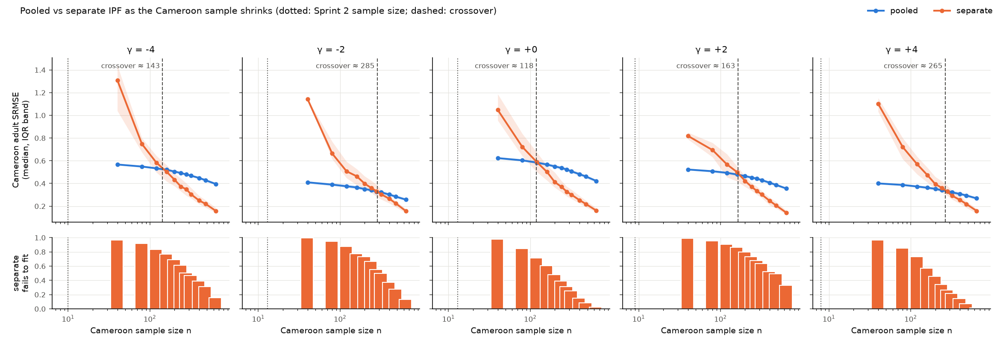

# Pooled and separate IPF, and the crossover (Sprint 3 draft)

Draft text for the Method section, plus first results. Code:
`src/synthpop/design_ipf.py` (the two designs), `src/synthpop/crossover.py`
(the thin-group experiment and plot), `src/synthpop/scoring.py` (first-pass
scores). Verification: `tests/test_design_ipf.py`.

**Status.** ACS results are in, from the run of 10 Nov 2026 on the full
Sprint 2 inputs (strict settings: no age bands merged; 50 replicates). The
run log holds the exact parameters and hashes. A simulated dry run is kept
at the end of the crossover section for comparison.

## The two designs as implemented

Both designs fit a table over origin *o* (5 levels) × sex *s* (2) × age band
*a* (8) × EDATTAIN *e* (5) by iterative proportional fitting (Deming &
Stephan 1940), using the Sprint 1 IPF code unchanged (tolerance 1e-10 on the
largest margin gap relative to the total, at most 1,000 cycles, strict). The
targets are the manufactured control margins: origin, origin × sex,
origin × age band. Education is in no margin. The seed is the biased sample
of 1,369, cross-classified. So all that a design says about education comes
from the seed: IPF rescales each (*o*, *s*, *a*) cell as a whole, and the
education distribution inside the cell is the seed's.

- **Pooled.** One IPF run over all origins at once, with origin carried as an
  attribute of the table. Every origin's slice of the seed is the whole
  sample's *s* × *a* × *e* table. Within each origin, sex and age cell, the
  synthetic education distribution is therefore the whole sample's for that
  sex and age band. Origins differ in education only through their sex and
  age mix.
- **Separate.** One IPF run per origin group, each with that group's own
  margins (its row of origin × sex and origin × age band) and its own slice of
  the sample as the seed. Within each cell, the synthetic education
  distribution is the group's own sample distribution. Nothing is shared.

These are the IPF counterparts of the max-entropy `pooled` and `separate`
variants (education shares over all origins vs within origin), so the four
cells of the design grid line up.

### Departure 1: "origin as an attribute" is not enough to pool

The plan describes pooled IPF as one run with origin as an attribute. Taken
literally, with the full sample (origin included) as the seed, that run gives
**exactly the separate design**. Every control margin is nested within origin
(origin, origin × sex, origin × age band), so the IPF updates never mix
origins, and the fit factorizes into one independent fit per origin.
`test_origin_in_the_seed_is_the_separate_design` checks this to 1e-8. Pooling
has to happen in the seed. The pooled design here collapses origin out of the
seed, which is the standard pooled-seed construction and matches the
max-entropy pooled variant. The literal version is kept in the code as
`joint`, for verification only.

This belongs in the paper. It says that with nested controls, the choice
between pooled and separate is entirely a choice about the seed. A margin
that crosses origins (for example, sex × age band without origin) would
break the factorization, and the two runs would differ even with the same
seed.

### Departure 2: failures are recorded, not fixed

IPF can only rescale, so a seed zero stays zero. When a group's sample slice
has nobody in a sex or age-band cell that its margins ask for, no table meets
the margins. The Sprint 1 code raises `InconsistentMarginsError` before
fitting. The design records the failure and the empty cells (for example,
`age_band=65+`), leaves that group's slice of the table undefined (NaN in
memory, `null` in `table.json`), draws no synthetic people for it, and scores
it as missing. Other groups are not affected. Non-convergence is recorded the
same way (`IPFConvergenceError`, the zero pattern passes the simple checks
but no table fits). It happened once in the simulated crossover (one of
800 separate fits, at n = 40).

The pooled design fails all-or-nothing: if the *whole* sample has nobody in a
cell some origin's margins ask for, the single run fails.

When a group does fit, the separate design still cannot put anyone in the
adult education cells its slice of the sample lacks. Those are the false
zeros of Auld, Mohammadian & Wies (2009), and they are counted
(`false_zeros`: adult cells zero in the synthetic table and positive in the
truth).

### Departure 3: an optional, reported age-band merge

Under-fives are rare in the truth. The ACS truth is people *born* in the
origin countries, so young children are mostly recent arrivals, and the
selection function controls only mean age and the 65+ share. In the
simulated runs the flow had 0.3% under 5. At γ = +2 and +4, the 1,369-person
sample (tilted against minors) had nobody under 5, so **pooled IPF failed
for every origin**. That failure has nothing to do with thin groups; the
age-band grid is finer than the sample can support.

So both CLIs take one optional, reported parameter:
`"ipf": {"drop_age_edges": [5]}` merges 0–4 into 5–17 (0–17) in the margins,
the seed and the scoring truth alike. It is global: it applies to every
origin and both designs, never merges origins, and does not depend on which
group is thin. That is the opposite of Auld's adaptive aggregation, which
would merge exactly the tail origins this study is about. The default is off
(strict). Recommendation: run once strict and report what fails, then run
with `[5]` for the comparison. Adult scores are unaffected, because all the
merged bands are under 18. Merging 65+ into 55–64 (`[5, 65]`) is available
too, but should be reported as a further coarsening if it is used.

## Scores (first pass; Sprint 4 builds the battery)

Every design that fits meets the control margins exactly, so differences sit
in education and its joint with sex and age band. Scores are computed
**within each origin group**, on **adults** (age bands 18+, since "less than
primary" among children mostly means not finished yet), against the flow
(the planted truth, read only for scoring):

- **SRMSE** over the group's adult *s* × *a* × *e* cells:
  √(mean (*x* − *t*)²) / mean *t*.
- **TVD** between the synthetic and true adult education distributions.
- **University-share error**, synthetic minus true.
- **False zeros**, as above.

`python -m synthpop.design_ipf` also scores the max-entropy tables, if
`design_maxent` has been run and no age bands were merged, so all four
designs print in one table.

### Results on the ACS inputs

**Pooled fitted at every γ.** The whole sample had people in every age band,
so the optional merge was not needed, and every result below is strict.

**Separate fitted only Venezuela at every γ.** Each of the other groups
failed at least once, and Cameroon and Cuba failed at every γ:

| γ | Separate could not fit (sample *n*; empty control cells) |
| ---: | --- |
| −4 | Haiti (92; 65+), Cuba (46; 65+), Ecuador (86; 65+), Cameroon (10; 0–4, 45–54, 65+) |
| −2 | Cuba (51; 0–4, 5–17), Ecuador (76; 0–4, 65+), Cameroon (13; 0–4, 5–17, 55–64) |
| 0 | Haiti (84; 65+), Cuba (47; 0–4), Cameroon (13; 0–4, 5–17, 55–64, 65+) |
| +2 | Cuba (44; 0–4), Ecuador (92; 65+), Cameroon (9; 0–4, 5–17, 65+) |
| +4 | Haiti (92; 0–4), Cuba (48; 0–4), Cameroon (8; 0–4, 5–17, 65+) |

Every failure was an empty **age band**, never education. The bands that
break the fit are the ones the selection makes rare: under-5s (rare among
people born abroad) and 65+ (0.5% by calibration). Groups of 80–90 sample
members still failed on a single empty band. So the separate design's
practical limit is set by the finest control margin, not by the planted
attribute.

**Adult SRMSE within origin:**

| γ | Design | Venezuela | Haiti | Cuba | Ecuador | Cameroon |
| ---: | --- | ---: | ---: | ---: | ---: | ---: |
| −4 | pooled | 0.273 | 0.773 | 0.664 | 0.828 | 0.577 |
| | separate | 0.293 | fail | fail | fail | fail |
| −2 | pooled | 0.200 | 0.899 | 0.849 | 0.979 | 0.426 |
| | separate | 0.246 | 0.666 | fail | fail | fail |
| 0 | pooled | 0.190 | 0.763 | 0.721 | 0.916 | 0.636 |
| | separate | 0.214 | fail | fail | 0.943 | fail |
| +2 | pooled | 0.183 | 0.907 | 0.799 | 0.911 | 0.534 |
| | separate | 0.225 | 1.391 | fail | fail | fail |
| +4 | pooled | 0.234 | 0.741 | 0.601 | 0.792 | 0.420 |
| | separate | 0.195 | fail | fail | 0.881 | fail |

**Adult university share, synthetic minus truth (percentage points):**

| γ | Design | Venezuela | Haiti | Cuba | Ecuador | Cameroon |
| ---: | --- | ---: | ---: | ---: | ---: | ---: |
| −4 | pooled | −0.8 | +22.6 | +18.8 | +21.8 | −9.6 |
| | separate | +2.8 | fail | fail | fail | fail |
| −2 | pooled | −0.2 | +24.3 | +21.8 | +24.9 | −4.3 |
| | separate | +3.2 | +6.6 | fail | fail | fail |
| 0 | pooled | −2.2 | +21.9 | +19.8 | +24.5 | −9.7 |
| | separate | +1.3 | fail | fail | +9.3 | fail |
| +2 | pooled | −1.2 | +22.3 | +20.2 | +23.9 | −4.0 |
| | separate | +3.0 | +0.4 | fail | fail | fail |
| +4 | pooled | −4.4 | +18.5 | +14.3 | +20.4 | −5.9 |
| | separate | −0.4 | fail | fail | +0.3 | fail |

What the tables say:

- **Pooled is Venezuela's design.** Venezuelans are 84% of the flow and of
  the sample, so the pooled seed is essentially the Venezuelan seed.
  Venezuela's scores barely depend on the design.
- **Pooling erases the between-group gaps in education.** Pooled
  overstates adult university completion by 14–25 points for Haiti, Cuba
  and Ecuador at every γ, and understates it by 4–10 points for Cameroon.
  This is the between-group shrinkage Sprint 4 is set up to measure, and it
  is already large here.
- **Where separate fits, it removes most of that bias.** For example: Haiti
  at γ = +2, +0.4 points against pooled's +22.3; Ecuador at γ = +4, +0.3
  against +20.4.
- **The two metrics disagree.** At those same fits, separate's SRMSE is
  *worse* (Haiti at γ = +2: 1.39 vs 0.91), because 40–90 people spread over
  six adult age bands × two sexes × five education levels give a noisy joint
  even when the education marginal is right. Which design wins a non-thin
  group depends on whether the target is the education distribution or its
  joint with age and sex. Sprint 4 should report both, and the paper should
  say which one the crossover uses (here, SRMSE of the joint).

## The crossover experiment

**Question.** At what sample size does separate estimation of a group stop
losing to pooled estimation?

**Procedure** (for each γ):

1. Keep every other origin's members of the Sprint 2 sample as they are.
2. For the thin group (Cameroon by default, the smallest group in the flow),
   draw Efraimidis–Spirakis keys over **all its members in the flow**, with the
   Sprint 2 tilt (SES +1, minor −1). The *n* smallest keys are a tilted sample
   of size *n*, and the samples are nested, so the curves share random
   numbers.
3. At each size *n* ∈ {5, 10, 20, 40, 80, 160, 320, 640} (capped at the
   group's flow count), replace the group's sample members with that draw.
   Fit both designs, and score the thin group.
4. Repeat for 50 independent key draws.

**Locating the crossover.** For each replicate where separate fits, take the
paired difference (separate SRMSE − pooled SRMSE, same sample). The crossover
is the size where the median paired difference turns from positive (pooled
better) to negative, interpolated on log *n*, after the last size at which
pooled is still better. Separate's failure rate is reported beside it, not
folded into it: a run that cannot fit has no error to compare. Separate's
error curve is therefore conditional on fitting. That makes separate look
better than it is at small *n*, which is one more reason to report the
failure rate.

### Departure 4: oversample first, then subsample down

The plan says to subsample the thin group down in steps. At the Sprint 2
shares, Cameroon is about 0.7% of the flow, so roughly 9 people in a sample
of 1,369. Subsampling down from 9 cannot show a crossover, because separate
estimation never wins that low. Step 2 therefore draws the group from the
flow (about 920 Cameroonians) as if the survey had oversampled it, then
subsamples down. The Sprint 2 size is marked on the plot.

Two side effects to state in the write-up:

- **Pooled moves too.** The thin group's members are part of the pooled seed,
  so pooled improves slightly as *n* grows.
- **The top of the grid is a large share of the group.** At *n* = 640 the
  sample is 56–63% of the group's flow members on the ACS inputs. Separate's error there is
  shrunk by the finite-population effect, which a real survey of a
  ~1,000-person group would also have. The crossover sits well below that in
  every simulated run where it was found.

### First results

Cameroon on the ACS inputs: 1,020–1,150 Cameroonians in the flow and 8–13 in
the Sprint 2 sample, depending on γ. Crossover is on paired adult SRMSE, with
50 replicates per size. Plot: `data/sprint3/crossover.png`.

| γ | −4 | −2 | 0 | +2 | +4 |
| --- | ---: | ---: | ---: | ---: | ---: |
| Cameroon in flow | 1,129 | 1,050 | 1,095 | 1,020 | 1,150 |
| Cameroon in Sprint 2 sample | 10 | 13 | 13 | 9 | 8 |
| **Crossover *n*** | **≈ 146** | **≈ 277** | **≈ 138** | **≈ 154** | **≈ 256** |
| Separate fails at *n* = 160 | 74% | 78% | 64% | 84% | 54% |
| Separate fails at *n* = 640 | 12% | 22% | 4% | 28% | 0% |
| Separate fails at the Sprint 2 size (*n* = 10–20) | 100% | 100% | 100% | 100% | 98–100% |

**The main result, first draft.** On the joint of education with sex and
age, separate estimation of Cameroon starts beating pooled at about **120 to
290 sample members** across the five SES selection strengths (fine run,
below). That is **9 to 36 times** what a BPM-sized survey gives the group. At the actual
size, separate cannot even be fitted: it failed in every replicate at every
γ (98% at *n* = 20, γ = +4).

Three caveats belong next to that number:

1. **The error crossover is not the usable threshold.** At the crossover,
   separate still fails to fit in 27–86% of draws (fine run). Its error curve is
   computed on the draws where it did fit, which flatters it. Separate fits
   reliably (≤ 5% failures) only at *n* = 640, for γ = 0 and +4. That is more
   than half of all Cameroonians in the flow.
2. **The crossover does not move monotonically with γ** (≈ 138 at γ = 0,
   ≈ 277 at γ = −2). The fine run below confirms this is real, not
   interpolation noise, and explains it.
3. **It depends on the metric.** On university share alone, the per-origin
   tables above suggest separate would win much earlier, because the
   pooled bias is large and the marginal is cheap to estimate. Sprint 4
   should locate the crossover under TVD of education too.

#### Fine run

Same inputs; sizes 40, 80, 120, 160, 200, 240, 280, 320, 400, 480, 640; 200
replicates per size (`configs/sprint2.json`, output `data/sprint3_fine/`).

| γ | −4 | −2 | 0 | +2 | +4 |
| --- | ---: | ---: | ---: | ---: | ---: |
| Crossover *n*, first pass (50 reps) | ≈ 146 | ≈ 277 | ≈ 138 | ≈ 154 | ≈ 256 |
| **Crossover *n*, fine run (200 reps)** | **≈ 143** | **≈ 285** | **≈ 118** | **≈ 163** | **≈ 265** |
| Pooled SRMSE at *n* = 40 | 0.567 | 0.410 | 0.624 | 0.523 | 0.401 |
| Separate fails at the nearest grid size to the crossover | 77% (160) | 50–55% (280–320) | 72% (120) | 86% (160) | 27% (280) |
| Separate fails at *n* = 640 | 16% | 14% | 3% | 33% | 1% |

The two runs agree within 20 people at every γ, so the crossover is stable
under replication. **It falls between about 120 and 290 Cameroonians**, 9 to
36 times the 8–13 in a BPM-sized sample.

**Why it isn't monotone in γ: the crossover tracks how far Cameroon is from
the pool.** Order the five γ by pooled SRMSE at the smallest size, which
measures how badly the borrowed (mostly Venezuelan) education pattern fits
Cameroon: 0.624 (γ = 0), 0.567 (−4), 0.523 (+2), 0.410 (−2), 0.401 (+4).
The crossovers come out in exactly that order: 118, 143, 163, 285, 265.
The last two are within replication noise of each other. The more
Cameroon's joint differs from the pooled one, the sooner its own sample
wins. That is the bias–variance trade the design question is about, and it
gives the result a mechanism: the threshold is a function of between-group
heterogeneity, not of the selection strength as such. A Sprint 4 check is
to plot crossover *n* against a direct heterogeneity measure (for example,
the TVD between Cameroon's and the pooled adult education distribution in
the truth).

**Usable is later still.** Separate fits in at least 95% of draws only at
*n* = 640 for γ = 0 and +4, and in none of the five γ before *n* = 480. At
the crossover itself it still fails in 27–86% of draws, always on an empty
age band.

Simulated dry run (three groups; the thin group is 1.5% of the flow, about
900 people, with 20–24 in the Sprint 2 sample; 20 replicates; `drop_age_edges
= [5]`). It is shown only to make the output concrete:

| γ | −4 | −2 | 0 | +2 | +4 |
| --- | ---: | ---: | ---: | ---: | ---: |
| Crossover *n* | ≈ 390 | not reached by 640 | ≈ 541 | ≈ 376 | ≈ 203 |

At the Sprint 2 size, separate failed in 70–100% of draws. All but one failure
was an empty age band, most often 65+ or 55–64; none involved education. In other words, a thin
group's separate fit usually breaks on the control margins before
education's false zeros ever matter, and that is worth saying in the
results.

## Verification (`tests/test_design_ipf.py`)

| Property | Test |
| --- | --- |
| Both designs meet every control margin exactly | `test_controls_hold_exactly` |
| Pooled: education within each origin × sex × age cell equals the whole sample's for that sex × age | `test_pooled_borrows_the_whole_sample_education_pattern` |
| Separate: equals the origin's own sample distribution, and differs from pooled | `test_separate_uses_each_origins_own_slice` |
| Origin in the seed + nested controls = separate | `test_origin_in_the_seed_is_the_separate_design` |
| A thin group with an empty control cell fails loudly, lists the cell, stays undefined; other groups unaffected | `test_thin_group_fails_loudly_and_is_not_patched` |
| Seed zeros cannot be filled (false zeros counted, university share biased down) | `test_separate_cannot_fill_seed_zeros` |
| Merged age-band margins equal margins of the merged flow | `test_coarsened_margins_equal_margins_of_the_coarsened_flow` |
| The nested-sample key function reproduces `draw_survey_sample` exactly | `test_draw_survey_sample_is_the_smallest_keys` |
| Crossover locator on hand-made curves; experiment end to end | `test_crossover_locator`, `test_crossover_experiment_runs_and_separate_stops_failing` |

## Assumptions added this sprint

- The thin group's oversample uses the same tilt as the main sample. The
  survey is assumed to reach the group the same way it reaches everyone else,
  only more often.
- Within-group scores on adults only. Children's education is scored in
  Sprint 4 only if it turns out to matter.
- The crossover is defined on SRMSE of the adult sex × age × education
  table. A different metric (TVD on education alone, university share) can
  move it, so Sprint 4 should report it under at least two.

## To read now that it breaks

Auld, Mohammadian & Wies (2009) on false-zero cells, and Auld & Mohammadian
(2010) on multi-level control. The aggregation threshold is
`drop_age_edges`, reported in every run's log entry.
