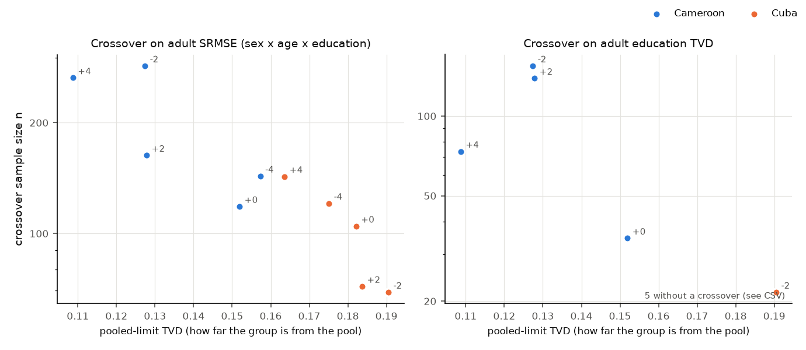

# Crossover against heterogeneity, and on education alone (Sprint 4 draft)

Extends the Sprint 3 crossover (`docs/sprint3_ipf_designs.md`) in three
ways:

1. **A second thin group.** Cuba is added next to Cameroon, because the
   separate design failed for Cuba at every γ, even with 44–51 sample
   members.
2. **A second metric.** The crossover is located twice: on adult SRMSE of
   the sex × age band × education table, as before, and on the TVD of the
   adult education distribution alone.
3. **A heterogeneity axis.** Each crossover is plotted against a direct
   measure of how far the group is from the pool.

Code: `src/synthpop/crossover.py` (`origins` and `metrics` config keys,
`plot_heterogeneity`) and `src/synthpop/scoring.py` (`heterogeneity`).
Config: the `crossover` block of `configs/sprint2.json`. Output:
`data/sprint4_crossover/`.

## Heterogeneity measures

Both are computed in the truth (the flow) at each γ, on adults:

- **Pooled-limit TVD** (the x-axis). Run pooled IPF with the *whole truth*
  as the seed, as if the sample were perfect and infinite: the pool's
  sex × age × education table fitted to the group's own sex and age margins.
  Then take the TVD between that and the group's true adult table. This is
  the bias pooled estimation keeps however large the sample, so it is the
  quantity the crossover should depend on. Separate estimation pays variance
  to remove it. `test_pooled_limit_is_what_pooled_ipf_gives_with_the_truth_as_seed`
  checks that the function equals that IPF run's error.
- **Education TVD vs pool.** TVD between the group's adult education
  distribution and all adults'. This is simpler, and it ignores the sex and
  age structure.

**Prediction.** The crossover *n* falls as pooled-limit TVD rises: the
further a group is from the pool, the sooner its own sample pays off. The
Sprint 3 fine run already showed this ordering for Cameroon across γ, using
pooled SRMSE at small *n* as a stand-in.

## Results

ACS run of 10 Nov 2026 (strict settings; 200 replicates; sizes 20–640).
Cuba has 5,061–5,185 people in the flow and 44–51 in the Sprint 2 sample;
Cameroon has 1,020–1,150 and 8–13.

### On the joint (adult SRMSE): one curve for both groups

| Origin | γ | Pooled-limit TVD | Education TVD vs pool | Crossover *n* |
| --- | ---: | ---: | ---: | ---: |
| Cameroon | +4 | 0.109 | 0.062 | 265 |
| Cameroon | −2 | 0.127 | 0.081 | 285 |
| Cameroon | +2 | 0.128 | 0.090 | 163 |
| Cameroon | 0 | 0.152 | 0.122 | 118 |
| Cameroon | −4 | 0.157 | 0.120 | 143 |
| Cuba | +4 | 0.164 | 0.143 | 143 |
| Cuba | −4 | 0.175 | 0.140 | 121 |
| Cuba | 0 | 0.182 | 0.157 | 105 |
| Cuba | +2 | 0.184 | 0.164 | 72 |
| Cuba | −2 | 0.191 | 0.158 | 69 |

The prediction holds. Across all ten group × γ points, the crossover falls
as the group's distance from the pool rises: Spearman ρ = −0.92 (−0.80
within Cameroon, −1.0 within Cuba). Cameroon and Cuba lie on **one
curve**. Cuba crosses earlier than Cameroon because it is further from the
pool, not because it is bigger. Cameroon's numbers reproduce the Sprint 3
fine run exactly, as designed.

On log–log axes the slope is about **−2.3** (Pearson *r* = −0.90 on the
logs). That is close to the −2 a simple bias–variance argument predicts.
Separate's error falls like *c*/*n*, while pooled keeps a squared bias of
order *b*², so the two meet near *n* ≈ *c*/*b*². Five γ per group and two
groups is too few points to pin the exponent, so the paper should say the
result is "consistent with an inverse-square law", not that it estimates
one. It is still the best sentence in the results: **how many people a
group needs before it can be estimated on its own scales with how different
it is, and roughly with the inverse square of that difference.**

### On education alone (adult education TVD): much earlier

| Origin | γ | Crossover *n* |
| --- | ---: | ---: |
| Cameroon | +4 | 74 |
| Cameroon | −2 | 155 |
| Cameroon | +2 | 139 |
| Cameroon | 0 | 35 |
| Cameroon | −4 | separate better throughout |
| Cuba | −2 | 22 |
| Cuba | +4, −4, 0, +2 | separate better throughout |

When the target is only the education distribution, separate estimation
wins at a few dozen sample members for Cuba, and at 35–155 for Cameroon.
That is often below the Sprint 2 sample size for Cuba (44–51). The
education marginal is cheap to estimate from a small sample (five cells),
while pooled's bias on it is large (pooled TVD 0.15–0.23 for Cuba). The
joint spreads the same sample over 60 cells. **The crossover is a property of
the target as much as of the group.** A design choice that is right for
reporting a group's education mix can be wrong for reporting education by
age and sex.

**Read "separate better throughout" with care.** It means separate won at
every size where it could be fitted, but at *n* = 20–40 it fitted in only
1–8% of the 200 draws (fails 92–99%). Those few fits are draws that happened
to cover every age band, so they are not a fair sample. The honest
statement is that separate wins on education whenever it fits at all, and
that it rarely fits below about 100.

### Feasibility, again

Fitting, not error, is the binding constraint:

| | Cameroon | Cuba |
| --- | --- | --- |
| Separate fails at the Sprint 2 size | 99–100% (n = 20) | 90–94% (n = 40) |
| Smallest *n* with ≤ 5% failures | 640, and only at γ = 0, +4 | 400–640 at every γ |

Cuba's failures are the same kind as Cameroon's, empty age bands, but they
disappear sooner because the flow has five times as many Cubans. For both
groups, separate estimation becomes *usable* at several times the size
where it becomes *better*.

## Reproducibility

Cameroon's random stream is unchanged from Sprint 3, so its SRMSE results
here reproduce the fine run at the shared sizes. Cuba gets its own stream.
Failure rates and empty control cells are reported as before. The separate
design is never patched.
